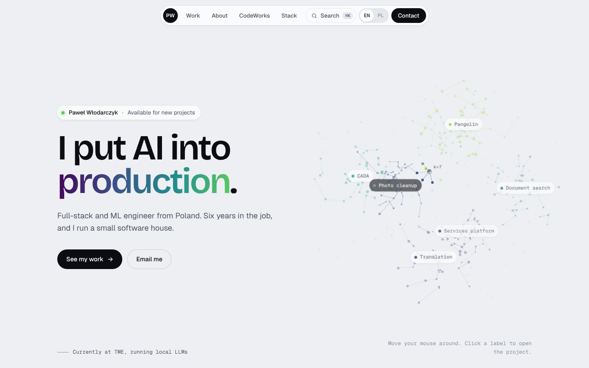
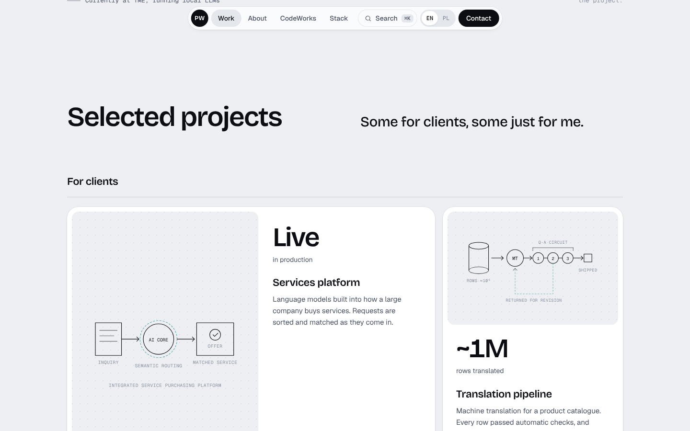
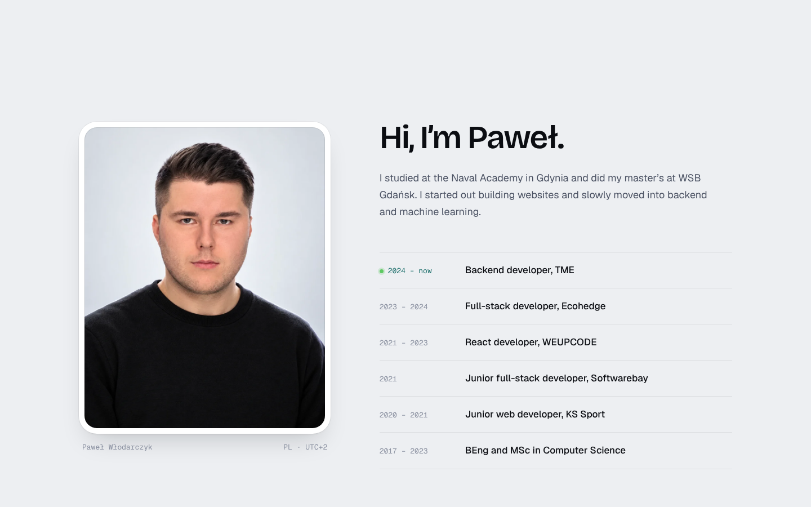
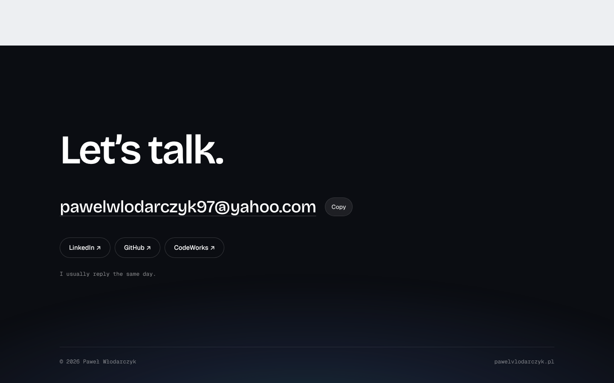
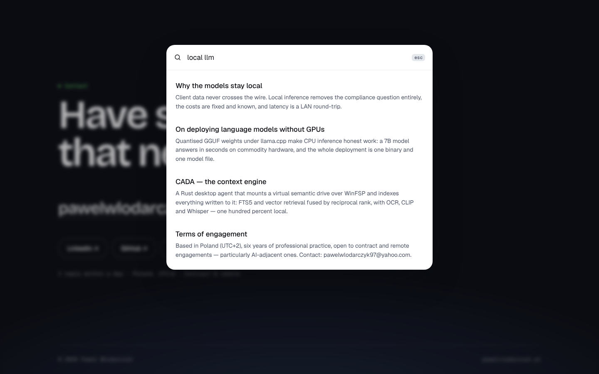

# Paweł Włodarczyk — portfolio

Personal site, React + TypeScript + Vite, prerendered to static HTML for `/`
(Polish) and `/en` (English). Live at **https://www.pawelvlodarczyk.pl/**.



```bash
npm install
npm run dev
```

| Script      | Does                                                    |
| ----------- | ------------------------------------------------------- |
| `dev`       | Vite dev server on :5173                                |
| `build`     | typecheck, client build, SSR build, prerender `/` `/en` |
| `preview`   | Serve `dist/`                                           |
| `typecheck` | Types only                                              |

`.github/workflows/deploy.yml` builds and deploys to GitHub Pages on every push
to `main`.

## The design

- **Hero:** the work plotted as an embedding space (`src/site/cloud.ts`, plain
  canvas 2D). The cursor acts as a k-nearest query; each project is a cluster,
  and its label jumps to the project card.
- **Type:** Bricolage Grotesque, Geist and Geist Mono, self-hosted via
  Fontsource. **Colour:** cool porcelain, near-black ink, viridis for data.
- **Motion:** staggered hero entrance, blur-fade reveal on scroll, scroll-scrubbed
  intro line, count-up stats, card spotlight. All of it respects
  `prefers-reduced-motion`, and nothing is hidden without JavaScript.
- **⌘K / Ctrl-K:** search over the archive notes, entirely in the page.

| | |
| --- | --- |
|  |  |
|  |  |

## Where things live

```
src/
  site/        Site.tsx (all sections) · cloud.ts · copy.ts (all visible copy) · portrait.ts
  content/     plates · archive · instruments · site  (typed data)
  components/  figures.tsx (the project diagrams)
  i18n/        Localized<T>, pluralize, LocaleProvider (URL, <html lang>, meta)
  lib/         searchArchive (pure, offline)
  styles/      site.css · print.css
public/        portrait.webp · og.png · favicon
```

Visible copy is in `src/site/copy.ts`, both languages side by side. To change
the photo, replace `public/portrait.webp` (4:5, about 960×1200).

## Print = CV

Ctrl/Cmd-P reflows the page into a two-page A4 CV in the language on screen:
the cloud, figures and navigation drop out, links print with their addresses.

## Two languages

The folio is set in Polish and English. There is no i18n dependency — the
seam is a type:

```ts
type Localized<T> = Readonly<Record<Locale, T>>;
```

Anything translatable is declared as `Localized<T>`, which puts both languages
adjacent in the source and makes a missing translation a **type error** rather
than a runtime fallback. What should *not* be translated stays a plain
value — tool names, URLs, figure ids, the engineer's own name — so the model
says out loud which is which:

```ts
title: { en: 'The Translation Engine', pl: 'Maszyna translatorska' },
stack: ['Python', 'FastAPI', 'CTranslate2'],
```

Components read through one hook, `const t = useT()`, then `t(plate.title)`.
Interface copy lives in `content/ui.ts`; content proper stays in its own module.

**Polish takes three plural forms** where English takes two, so counts go
through `pluralize()` — *1 zapis odnaleziony*, *2 zapisy odnalezione*,
*5 zapisów odnalezionych*, including the 12–14 exception. Sentences with
numbers in them are templates with `{placeholders}`, never concatenation, so
word order and punctuation stay inside the translation — Polish gets its own
quotation marks (`„…”`) that way.

The choice persists to `localStorage`, falls back to the browser's languages,
and drives `<html lang>` and the tab title.

### Retrieval across both

Archive tags are **shared between languages** rather than translated, so one
record is reachable from either — a Polish reader searching *wykształcenie* and
an English one searching *education* land on the same card. Only the prose is
scored in the language on screen.

Folding strips diacritics so `gdansk` finds `Gdańsk`. Note `ł`: unlike `ą` or
`ś` it has no canonical decomposition, so NFD leaves it whole and a naive
tokenizer splits `wykształcenie` in half — it is mapped to `l` explicitly
before normalising.

Matching is stem-based rather than prefix-based, because the two languages
inflect differently. English appends (`deploy` → `deployment`), so a prefix
test carries it. Polish *changes the ending* — `wdrożenie` / `wdrożenia` /
`wdrożeniu` — where neither form is a prefix of the other, and a prefix test
returns nothing at all. Two words therefore also match when they share a stem
of at least four letters and part ways only in the last two. The slack stops
at two deliberately: `kontrakt` and `kontrola` share five letters, which is
not enough to confuse them.
